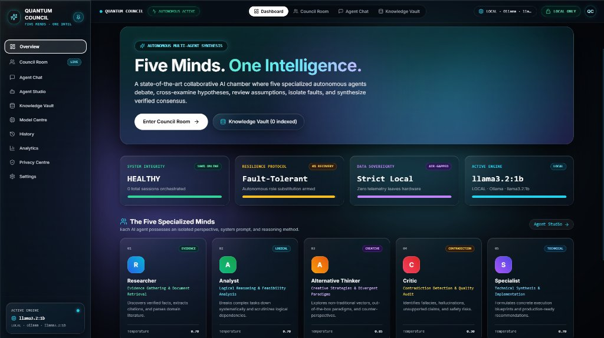
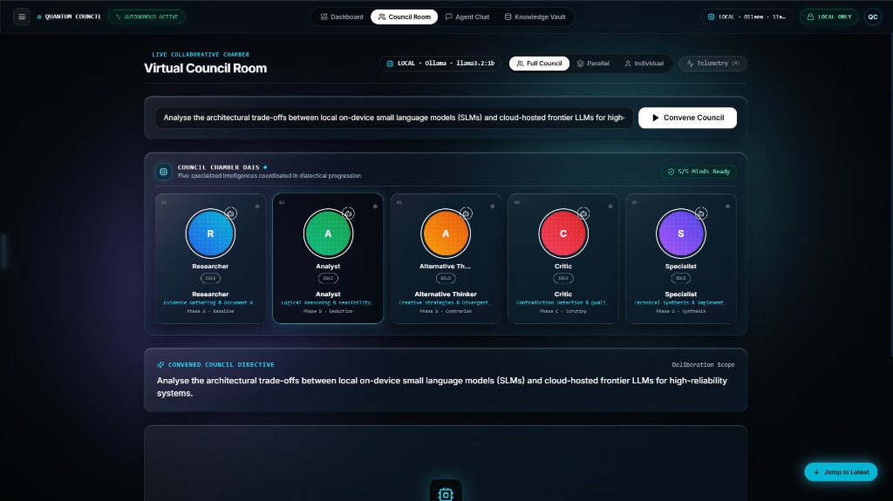
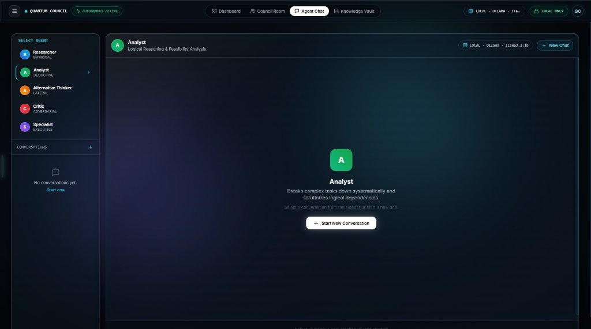
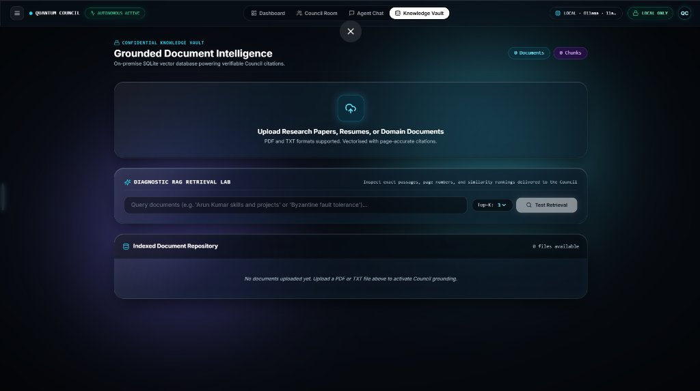
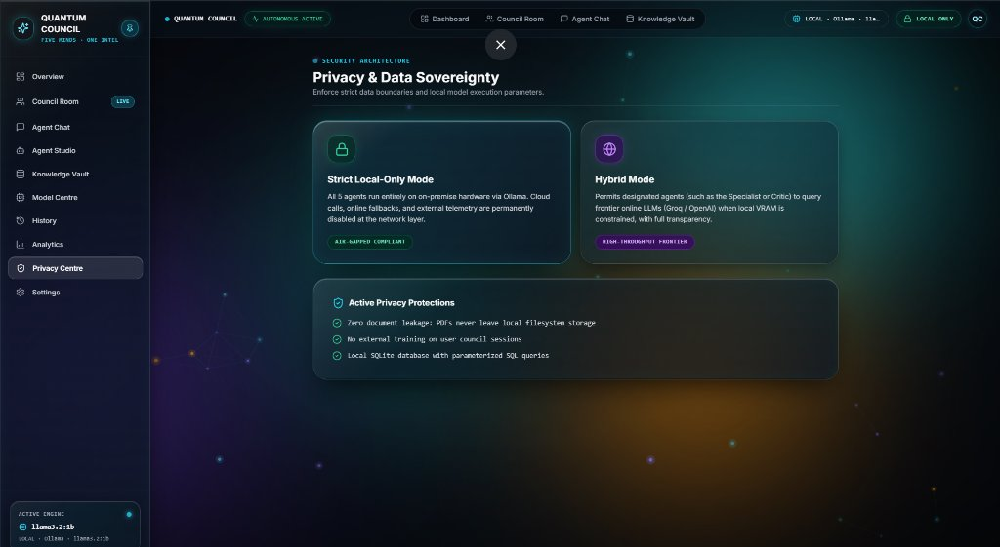
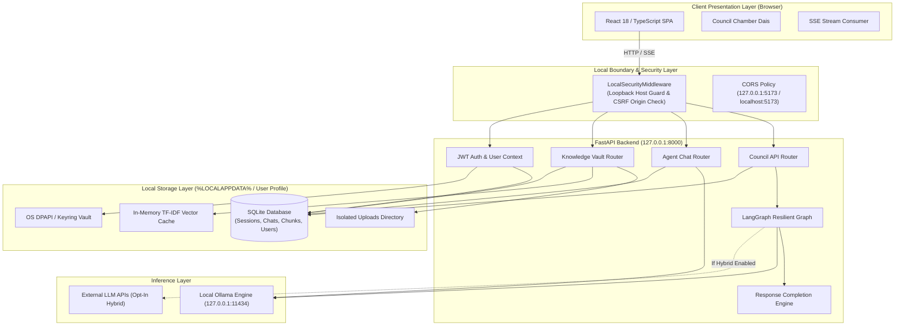
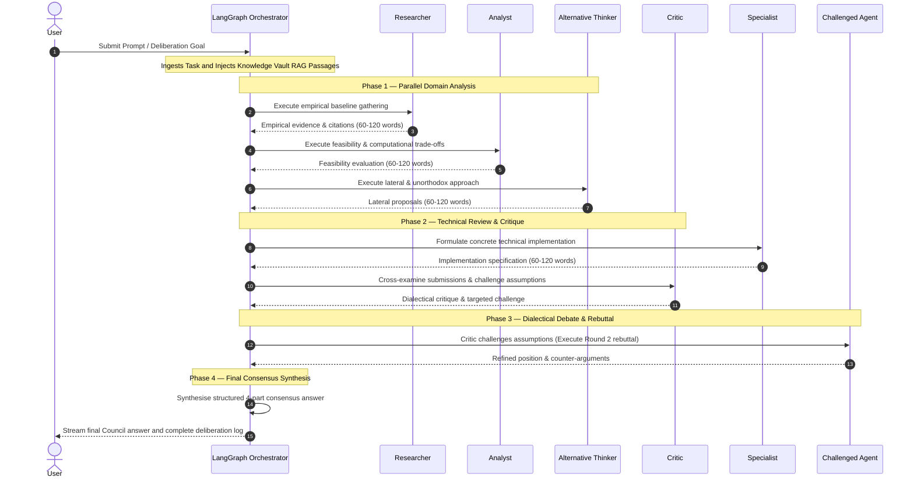
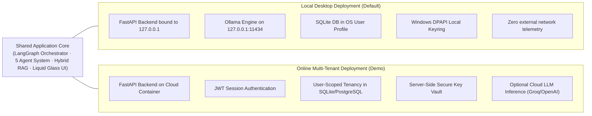

# 🏛️ Quantum Council

### *Five Minds. One Intelligence — Multi-Agent Collaborative Deliberation*

[](https://python.org)
[](https://fastapi.tiangolo.com)
[](https://react.dev)
[](https://vitejs.dev)
[](https://langchain-ai.github.io/langgraph/)
[](https://ollama.ai)
[](LICENSE)
[](backend/tests/)

---

<p align="center">
  
  <br />
  <em><b>Quantum Council Command Centre</b> — Real-time telemetry, active local model engine, and cognitive agent profiles in dark glassmorphism.</em>
</p>

---

## 📑 Table of Contents

- [1. Project Introduction](#1-project-introduction)
- [2. Problem Statement](#2-problem-statement)
- [3. Key Features](#3-key-features)
- [4. Visual Interface & Demonstration](#4-visual-interface--demonstration)
- [5. Five Specialized Agent Roles](#5-five-specialized-agent-roles)
- [6. Deliberation & Interaction Modes](#6-deliberation--interaction-modes)
- [7. Architecture Overview (Diagram A)](#7-architecture-overview)
- [8. Full Council Deliberation Workflow (Diagram B)](#8-full-council-deliberation-workflow)
- [9. Knowledge Vault and RAG Workflow (Diagram C)](#9-knowledge-vault-and-rag-workflow)
- [10. Technology Stack](#10-technology-stack)
- [11. Requirements and Prerequisites](#11-requirements-and-prerequisites)
- [12. Installation from Fresh Git Clone](#12-installation-from-fresh-git-clone)
- [13. Environment Configuration](#13-environment-configuration)
- [14. Local Model Configuration (Ollama)](#14-local-model-configuration-ollama)
- [15. Online Model Configuration (Opt-In Hybrid Mode)](#15-online-model-configuration-opt-in-hybrid-mode)
- [16. Startup Instructions](#16-startup-instructions)
- [17. Testing Instructions (71 Tests)](#17-testing-instructions)
- [18. Privacy and Security Architecture (Diagram D)](#18-privacy-and-security-architecture)
- [19. Common Troubleshooting](#19-common-troubleshooting)
- [20. Known Limitations](#20-known-limitations)
- [21. Contributing](#21-contributing)
- [22. License](#22-license)
- [23. Author](#23-author)

---

## 📖 1. Project Introduction

**Quantum Council** is a local-first multi-agent AI deliberation system designed to break complex engineering, scientific, and architectural questions out of single-model bias. By coordinating five specialized autonomous agents through an orchestrated deliberation graph, the platform conducts multi-perspective analysis, cross-examination, critique, and synthesis before delivering a single grounded consensus answer.

Built with a **FastAPI** backend, a **LangGraph** state machine, an **Ollama** local inference engine, and a **React 18 TypeScript** frontend, Quantum Council operates entirely on local hardware with zero required cloud dependencies.

---

## 🔍 2. Problem Statement

Single-prompt Large Language Model interactions suffer from systematic failure modes:

- ❌ **Perspective Blind Spots**: A single model turn optimizes for plausibility rather than critical scrutiny, frequently missing secondary trade-offs.
- ❌ **Unchallenged Assumptions**: Without dialectical debate, models fail to cross-examine their own premises.
- ❌ **Privacy Leakage**: Commercial AI collaboration platforms routinely send sensitive engineering schemas, internal documents, and corporate transcripts to third-party cloud infrastructure.
- ❌ **Disconnected Retrieval**: Conventional RAG implementations often dump large text chunks into a generic prompt without rigorous page-level attribution or specialized analytical roles.

Quantum Council solves this by decomposing tasks across distinct cognitive personas, enforcing structured cross-agent critique, isolating data locally, and grounding deliberations in an indexed Knowledge Vault with verified page-by-page citations.

---

## ✨ 3. Key Features

- 🧠 **Five Autonomous Cognitive Roles**: Discrete persona prompts specifically tuned for empirical research, algorithmic feasibility, lateral alternatives, dialectical critique, and production implementation.
- ⚡ **Fault-Tolerant LangGraph Orchestration**: Dynamic state machine with per-agent circuit breakers, automated retry policies, and role substitution if a local model fails.
- 🔒 **Strict Local-First Privacy Boundary**: Operates offline via Ollama. Conversations, SQLite databases, and document indexes reside exclusively in the operating system's local user profile directory (`%LOCALAPPDATA%\QuantumCouncil`).
- 📚 **Verifiable Knowledge Vault (Hybrid RAG)**: Pure-Python page-by-page document extraction (PDF, Markdown, TXT), cohesive text chunking, and hybrid scoring combining TF-IDF cosine similarity, keyword overlap, and phrase boosting.
- 🎯 **Three Deliberation Modes**: Tailored execution workflows ranging from low-latency 1-on-1 dialogue to the comprehensive 5-agent deliberation chamber.
- 🛡️ **Multi-Tenant User Isolation & IDOR Protection**: Scoped database records preventing cross-user conversation, document, or session leakage in multi-user deployments.
- 🌊 **Real-Time Token Streaming**: Server-Sent Events (SSE) stream incremental agent deliberations and status telemetry to the presentation layer without blocking the UI thread.
- 🔐 **Hardware-Backed Credential Security**: Cloud API tokens (for opt-in hybrid mode) are protected via Windows DPAPI hardware keyrings or Fernet encryption before persisting to disk.

---

## 🖼️ 4. Visual Interface & Demonstration

Experience the intuitive glassmorphic interface engineered for real-time multi-agent visibility:

### 🏛️ Virtual Council Room — Collaborative Chamber
The centerpiece deliberation arena where five specialized agent intelligences assemble on the Dais, debate hypotheses across structured rounds, and present their verified consensus.

<p align="center">
  
</p>

### 💬 Individual Agent Chat — Targeted 1-on-1 Dialogue
Engage directly with a specific specialist mind (Researcher, Analyst, Alternative Thinker, Critic, or Specialist) for low-latency queries, isolated algorithmic analysis, or rapid prototyping.

<p align="center">
  
</p>

### 📚 Knowledge Vault — Grounded Document Intelligence & Diagnostic RAG
Upload PDFs, research papers, or markdown notes. Inspect exact indexed passages, page numbers, and similarity rankings before injecting grounded evidence into Council deliberations.

<p align="center">
  
</p>

### 🛡️ Privacy Centre — Local Sovereignty & Execution Boundaries
Toggle between Strict Local-Only Mode (air-gapped, zero network telemetry, Ollama on-device execution) and Hybrid Mode (opt-in cloud frontier LLMs for high-throughput synthesis).

<p align="center">
  
</p>

---

## 🧠 5. Five Specialized Agent Roles

Each agent operates under a tailored system prompt and focused cognitive objective:

| Agent | Icon | Identity & Role | Core Focus & Output Specification |
| :--- | :---: | :--- | :--- |
| **Researcher** | 🔍 | Empirical Baseline & Evidence | Retrieves verified factual baselines, benchmarks, and document citations from the Knowledge Vault. Outputs empirical facts within 60–120 words. |
| **Analyst** | 📊 | Feasibility & Algorithmic Trade-offs | Evaluates computational complexity, scalability, bottlenecks, and quantitative constraints within 60–120 words. |
| **Alternative Thinker** | 💡 | Lateral & Unorthodox Approaches | Challenges conventional engineering patterns by proposing contrarian, out-of-the-box, or lateral methodologies within 60–120 words. |
| **Critic** | ⚖️ | Dialectical Review & Cross-Examination | Identifies single points of failure, unstated assumptions, and flaws across peers. Challenges one specific agent to Round 2 debate. |
| **Specialist** | ⚙️ | Concrete Implementation Architecture | Formulates exact implementation specifications, architectural code structures, and concrete deployment requirements within 60–120 words. |

---

## 💬 6. Deliberation & Interaction Modes

### 🎯 Mode 1 — Individual Agent
Direct 1-on-1 dialogue with a single specialized mind. Designed for focused, rapid iteration (e.g., querying the Specialist for a specific algorithm or the Researcher for document verification). Sub-4s local response time.

### 🌐 Mode 2 — Parallel Collaboration
Broadcasts the user prompt simultaneously to all five agents without cross-talk. Each agent produces an independent perspective in parallel, allowing users to compare diverse domain viewpoints side by side.

### 🏛️ Mode 3 — Full Council
The core orchestrated deliberation chamber. Executes a structured multi-round protocol:
1. 📥 **Ingestion**: Orchestrator ingests task and retrieves grounded evidence from the Knowledge Vault.
2. 🔍 **Phase 1 (Parallel Domain Analysis)**: Researcher, Analyst, and Alternative Thinker generate empirical, feasibility, and lateral perspectives.
3. ⚖️ **Phase 2 (Technical Review & Critique)**: Specialist formulates concrete implementation while the Critic cross-examines submissions and challenges one agent.
4. 🔄 **Phase 3 (Dialectical Debate & Rebuttal)**: The challenged agent provides a structured Round 2 rebuttal.
5. 📝 **Phase 4 (Consensus Synthesis)**: Orchestrator synthesizes a mandatory 4-part consensus answer.

---

## 🏗️ 7. Architecture Overview

### Diagram A — Overall System Architecture



---

## 🔄 8. Full Council Deliberation Workflow

### Diagram B — Full Council Deliberation Workflow



---

## 📚 9. Knowledge Vault and RAG Workflow

### Diagram C — Knowledge Vault RAG Workflow

```mermaid
flowchart TD
    subgraph Ingestion ["1. Document Ingestion Pipeline"]
        Upload["User uploads PDF / TXT / MD"] --> Validate{"File & Path Validation"}
        Validate -- Invalid / Path Traversal --> Reject["Reject Request (HTTP 400 / 413)"]
        Validate -- Valid Document --> Extract["Page-by-Page Text Extraction (pypdf)"]
        Extract --> Chunking["Semantic Chunk Partitioning (300-650 chars)"]
        Chunking --> TFIDF["Calculate Normalized TF-IDF Vectors"]
        TFIDF --> PersistChunks[("Persist Document & Chunks to SQLite")]
        PersistChunks --> CacheIndex["Update In-Memory Vector Index"]
    end

    subgraph Retrieval ["2. Retrieval & Evidence Injection"]
        UserQuery["User Submits Query"] --> FilterQuery["Tokenize & Filter English Stopwords"]
        FilterQuery --> QueryVec["Compute Query Term-Frequency Vector"]
        QueryVec --> HybridRank["Calculate Cosine Similarity & Keyword Overlap"]
        HybridRank --> SelectTopK["Rank & Select Top-K Relevant Chunks"]
        SelectTopK --> ContextAssemble["Assemble Citations: [Source: file.pdf, Page X]"]
        ContextAssemble --> InjectAgent["Inject Context Block into Researcher / Council Prompt"]
    end
```



---

## 🛠️ 10. Technology Stack

### 🐍 Backend Infrastructure
- **Runtime**: Python 3.12+
- **API Framework**: FastAPI 0.115 / Starlette (Async ASGI engine)
- **Multi-Agent Orchestration**: LangGraph 0.2 / LangChain Core
- **Database & Persistence**: SQLite via SQLAlchemy 2.0 (ORM) + aiosqlite
- **Local Inference Engine**: Ollama REST API (`llama3.2:1b`, `llama3:8b`, `mistral:7b`)
- **Document Processing**: `pypdf` page-level extraction + pure-Python normalized TF-IDF vectorizer
- **Security & Cryptography**: Windows DPAPI (`wincrypto`), `cryptography` (Fernet), `python-jose` (JWT), `bcrypt`

### ⚛️ Frontend Application
- **Framework**: React 18 / TypeScript
- **Tooling & Bundler**: Vite 6
- **Styling**: Tailwind CSS + Custom Liquid Glass Optical CSS Engine
- **Motion & Dynamics**: Framer Motion + GPU-accelerated CSS keyframe compositing
- **Icons**: Lucide React
- **Markdown & Code Rendering**: React-Markdown + SyntaxHighlighter + Remark-GFM

---

## 📋 11. Requirements and Prerequisites

Before installation, verify the following prerequisites:

1. 💻 **Operating System**: Windows 10/11 (fully supported with DPAPI credential security), Linux, or macOS.
2. 🐍 **Python**: Version `3.12.x` (or `>= 3.11`).
3. 📦 **Node.js**: Version `18.x` or `>= 20.x` (`npm` included).
4. 🦙 **Ollama**: Download and install from [ollama.ai](https://ollama.ai).
5. 🐙 **Git**: Installed and configured on your command line.

---

## 💻 12. Installation from Fresh Git Clone

Follow these steps to clone, configure, and install Quantum Council.

### 🪟 Windows (PowerShell)

```powershell
# 1. Clone the repository
git clone https://github.com/kishanth-m/Quantum-Council.git
cd Quantum-Council

# 2. Create and activate a Python virtual environment
python -m venv .venv
.\.venv\Scripts\Activate.ps1

# 3. Upgrade pip and install backend dependencies
python -m pip install --upgrade pip
pip install -r backend/requirements.txt

# 4. Copy the environment configuration template
Copy-Item .env.example .env

# 5. Install frontend dependencies
cd frontend
npm install
cd ..
```

### 🐧 Linux / macOS (Bash)

```bash
# 1. Clone the repository
git clone https://github.com/kishanth-m/Quantum-Council.git
cd Quantum-Council

# 2. Create and activate a Python virtual environment
python3 -m venv .venv
source .venv/bin/activate

# 3. Upgrade pip and install backend dependencies
pip install --upgrade pip
pip install -r backend/requirements.txt

# 4. Copy the environment configuration template
cp .env.example .env

# 5. Install frontend dependencies
cd frontend
npm install
cd ..
```

---

## ⚙️ 13. Environment Configuration

The repository provides a secure template at `.env.example`. Create your local `.env` file and review key options:

```bash
# Copy template to active configuration
cp .env.example .env
```

Key environment parameters:

```ini
# Application Mode
APP_NAME="Quantum Council"
ENVIRONMENT="production"
DEBUG=false

# Network Boundary (Local Loopback)
HOST="127.0.0.1"
PORT=8000

# Security (Generate a random 64-character hex key)
# python -c "import secrets; print(secrets.token_hex(32))"
SECRET_KEY="REPLACE_WITH_A_RANDOM_64_CHAR_HEX_KEY"

# Ollama Local Engine
OLLAMA_BASE_URL="http://127.0.0.1:11434"
OLLAMA_DEFAULT_MODEL="llama3.2:1b"
OLLAMA_TIMEOUT=120

# Privacy Boundary: "local_only" (default) or "hybrid"
DEFAULT_PRIVACY_MODE="local_only"

# Upload and Storage Limits
UPLOAD_DIR="./uploads"
MAX_UPLOAD_SIZE_MB=50
```

---

## 🦙 14. Local Model Configuration (Ollama)

Quantum Council requires an Ollama daemon running on your machine:

```powershell
# 1. Verify Ollama is running
ollama --version

# 2. Pull the default high-performance lightweight model
ollama pull llama3.2:1b

# 3. (Optional) Pull additional models for specific agents
ollama pull mistral:7b
ollama pull llama3:8b
```

Once pulled, models appear automatically in the **Model Centre** page of the Quantum Council UI.

---

## 🌐 15. Online Model Configuration (Opt-In Hybrid Mode)

If you explicitly choose to use external cloud providers (e.g., Groq, OpenAI-compatible APIs):

1. Set `DEFAULT_PRIVACY_MODE=hybrid` in `.env` (or toggle **Hybrid Mode** in the UI **Privacy Centre**).
2. Navigate to **Model Centre** in the browser interface.
3. Select your provider, enter the API key, and assign the model to individual agents.
4. All keys are encrypted before storage using Windows DPAPI or Fernet cryptography. Plaintext keys are never stored in database columns or logs.

---

## 🚀 16. Startup Instructions

### ⚡ Automated Startup (Windows Quickstart)

A consolidated PowerShell script verifies prerequisites and starts both services:

```powershell
powershell -ExecutionPolicy Bypass -File scripts/run.ps1
```

### 🛠️ Manual Startup (Two Terminals)

#### Terminal 1 — Backend API
```powershell
# Activate virtual environment
.\.venv\Scripts\Activate.ps1

# Start the FastAPI server
cd backend
uvicorn app.main:app --host 127.0.0.1 --port 8000 --reload
```

#### Terminal 2 — Frontend Application
```powershell
# Start Vite development server
cd frontend
npm run dev
```

Open your browser at:
- 🌐 **Frontend Dashboard**: [http://localhost:5173](http://localhost:5173)
- 📑 **Backend API Documentation**: [http://127.0.0.1:8000/docs](http://127.0.0.1:8000/docs) (available when `DEBUG=true`)

---

## 🧪 17. Testing Instructions

Quantum Council enforces automated testing across both backend and frontend layers:

### 🐍 Backend Pytest Suite (71 Tests)

Run the full unit and integration test suite:

```powershell
.\.venv\Scripts\python.exe -m pytest backend/tests/unit backend/tests/integration -v
```

Test coverage includes:
- ✅ Multi-agent state transitions and recovery workflows (`test_recovery_workflow.py`).
- ✅ Knowledge Vault PDF extraction and hybrid vector retrieval (`test_rag_pipeline.py`).
- ✅ Agent circuit breaker thresholds and failure recovery (`test_resilience.py`).
- ✅ Cross-user conversation, document, and session isolation (`test_security_hardening.py`).
- ✅ Insecure direct object reference (IDOR) rejection (`test_security_hardening.py`).
- ✅ Host header anti-DNS rebinding and CSRF origin verification (`test_security_hardening.py`).
- ✅ Path traversal rejection on document upload (`test_security_hardening.py`).

### ⚛️ Frontend Production Build

Validate TypeScript types and build the production bundle:

```powershell
npm --prefix frontend run build
```

---

## 🛡️ 18. Privacy and Security Architecture

### Diagram D — Online vs Local Deployment Architecture



### 🔒 Security Defenses Implemented

1. 🛡️ **Host Header Validation**: `LocalSecurityMiddleware` rejects non-loopback HTTP Host headers to protect against DNS rebinding attacks.
2. 🌐 **Cross-Origin CSRF Protection**: Validates the `Origin` header on state-changing HTTP methods (`POST`, `PUT`, `DELETE`, `PATCH`). Requests from untrusted origins are rejected with `403 Forbidden`.
3. 🔐 **Hardware-Backed Credential Security**: Cloud API tokens are encrypted via Windows DPAPI before storage. Keys are masked in all API responses.
4. 🧱 **Data Isolation & IDOR Protection**: Endpoints enforce user ownership checks. Users cannot view, modify, or delete another user's conversations, uploaded documents, or session history.
5. 🚫 **Path Traversal Guards**: Uploaded filenames are sanitized (`os.path.basename` + regex character whitelist), preventing directory escape attempts (`../../evil.pdf`).
6. 🔒 **Defensive HTTP Headers**: Enforces `X-Content-Type-Options: nosniff`, `X-Frame-Options: DENY`, `Referrer-Policy: strict-origin-when-cross-origin`, and restrictive `Permissions-Policy`.

---

## 🔧 19. Common Troubleshooting

| Symptom | Probable Cause | Recommended Resolution |
| :--- | :--- | :--- |
| `Ollama connection refused (127.0.0.1:11434)` | Ollama service is not running | Launch Ollama by running `ollama serve` in a terminal or launching the Ollama desktop tray application. |
| `Model 'llama3.2:1b' not found` | Model has not been pulled locally | Run `ollama pull llama3.2:1b` in terminal. Verify available models with `ollama list`. |
| `HTTP 403 Forbidden: Cross-origin request blocked` | Frontend origin does not match backend configuration | Verify `ALLOWED_ORIGINS` in `.env` contains `http://localhost:5173,http://127.0.0.1:5173`. |
| `HTTP 413: File exceeds maximum upload size` | Uploaded document exceeds size limit | Increase `MAX_UPLOAD_SIZE_MB` in `.env` (default is 50MB) and restart the backend. |
| `PDF text extraction returns empty` | Uploaded file is a scanned image without OCR text | Upload a digitally rendered PDF with selectable text, or pre-process with OCR software. |

---

## ⚠️ 20. Known Limitations

- 📄 **OCR Processing**: Scanned image PDFs without a digital text layer are not automatically transcribed; digital text extraction via `pypdf` is currently required.
- ⚡ **Hardware-Dependent Inference**: Deliberation speed on local hardware depends on available CPU/VRAM. Models $\ge 8\text{B}$ parameters require 8GB+ VRAM for optimal token generation.
- 👤 **Desktop Single-Tenant Default**: In default local desktop mode, the application operates as a single-user system. Multi-user session isolation activates when user accounts are registered and authenticated via JWT.

---

## 🤝 21. Contributing

Contributions are welcome. Please read [CONTRIBUTING.md](CONTRIBUTING.md) for branch naming conventions, pull request guidelines, and code style standards.

```bash
# 1. Fork and create a feature branch
git checkout -b feature/agent-streaming-enhancement

# 2. Run backend and frontend test suites
pytest backend/tests/
npm --prefix frontend run build

# 3. Submit a Pull Request
```

---

## 📄 22. License

This project is licensed under the MIT License. See the [LICENSE](LICENSE) file for details.

---

## 👤 23. Author

**Kishanth M.**
- 🐙 **GitHub**: [https://github.com/kishanth-m](https://github.com/kishanth-m)
- 💼 **LinkedIn**: [https://linkedin.com/in/kishanth-m-aa055b2a3/](https://linkedin.com/in/kishanth-m-aa055b2a3/)

*AI Engineering student specializing in multi-agent orchestration, LLMs, hybrid RAG, and local-first privacy architecture.*
