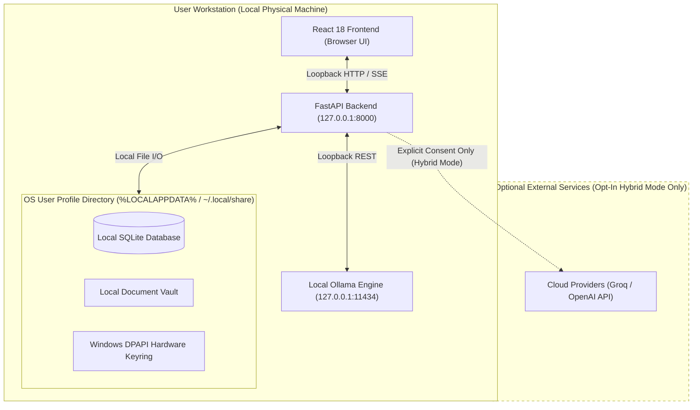
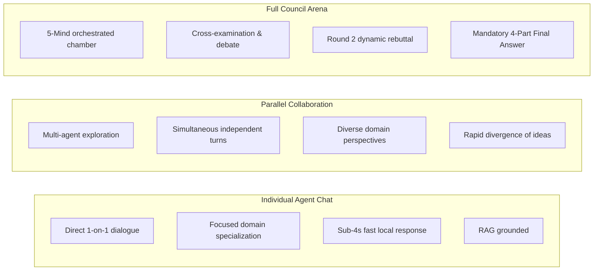
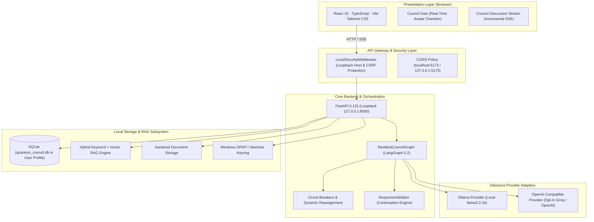

# Quantum Council
**Five Minds. One Intelligence.**

A privacy-first, local-first multi-agent AI system where specialised AI agents collaborate, challenge perspectives, and synthesise intelligent answers.

[](LICENSE)
[](https://www.python.org/)
[](https://fastapi.tiangolo.com/)
[](https://react.dev/)
[](https://www.typescriptlang.org/)
[](https://github.com/langchain-ai/langgraph)
[](https://ollama.com/)
[](docs/PRIVACY.md)

[GitHub Repository](https://github.com/kishanth-m/Quantum-Council) · [Architecture Guide](docs/architecture.md) · [Execution Workflows](docs/WORKFLOW.md) · [Privacy Architecture](docs/PRIVACY.md) · [Security Policy](SECURITY.md)

---

## Table of Contents
1. [Project Overview](#1-project-overview)
2. [Key Features](#2-key-features)
3. [Agent Architecture](#3-agent-architecture)
4. [Workflow Diagrams](#4-workflow-diagrams)
5. [System Architecture](#5-system-architecture)
6. [Technology Stack](#6-technology-stack)
7. [Privacy & Security](#7-privacy--security)
8. [Installation Guide](#8-installation-guide)
9. [Model Configuration](#9-model-configuration)
10. [Project Structure](#10-project-structure)
11. [Testing & Quality Assurance](#11-testing--quality-assurance)
12. [Roadmap](#12-roadmap)
13. [Contributing](#13-contributing)
14. [Security Policy](#14-security-policy)
15. [License](#15-license)
16. [Author](#16-author)

---

## 1. Project Overview

### The Limitation of Single-Model AI
Standard conversational AI relies on a single monolithic prompt-response cycle. While powerful, a single model response often suffers from cognitive blind spots:
- **Confirmation bias**: Early assumptions are reinforced rather than challenged.
- **Unverified claims**: Factual assumptions pass without adversarial inspection.
- **Premature convergence**: The first viable solution is selected without exploring alternative technical paradigms.
- **Privacy vulnerability**: Prompts and proprietary documents are typically transmitted to external third-party cloud infrastructure.

### The Collaborative Intelligence Solution
Quantum Council replaces single-model generation with a **dialectical multi-agent collaboration arena**. Rather than asking one model to produce an answer, user queries are addressed by five specialised AI minds with complementary analytical biases. The agents cross-examine each other's reasoning, trigger adversarial rebuttals, and converge into a structured consensus.

### Local-First Sovereignty
Quantum Council runs entirely on your local workstation via [Ollama](https://ollama.com/). Document extraction, vector embeddings, chunk storage, and model inferences stay inside your local machine boundary by default.

---

## 2. Key Features

- **Five Specialised AI Agent Minds**: Empirical Researcher, Analytical Evaluator, Lateral Thinker, Adversarial Critic, and Implementation Specialist.
- **Dialectical Debate & Cross-Examination**: The Critic reviews peer submissions and challenges a selected agent to a Round 2 rebuttal, refining the consensus before final synthesis.
- **Controlled Conversational Turns**: Natural, concise agent responses (~60–120 words) with bounded continuation to eliminate truncated sentences or unclosed code blocks.
- **Mandatory 4-Part Final Council Answer**: Guaranteed structured consensus containing (1) Direct Answer, (2) Key Council Insights, (3) Recommendation & Conclusion, and (4) Important Considerations.
- **Three Flexible Interaction Modes**: Individual Agent Chat (1-on-1 direct dialogue), Parallel Collaboration, and Full Council Dialectical Arena.
- **Knowledge Vault (Hybrid RAG)**: Local PDF, Markdown, and text ingestion with page-accurate digital text extraction, persistent SQLite chunks, and verifiable citations (`[Source: document.pdf, Page 2]`).
- **Resilient Circuit Breakers & Reassignment**: Fault-tolerant orchestrator graph that absorbs transient provider errors, redistributes tasks, and prevents deliberation hangs.
- **Multi-Tier Credential Protection**: Native **Windows DPAPI** encryption hardware-bound to the user's OS login, with an isolated 256-bit Fernet key fallback on Linux/macOS.
- **Local Loopback Security**: Backend bound to `127.0.0.1` with Host header validation (anti-DNS rebinding) and Cross-Origin CSRF protection.
- **Complete Storage Management**: Real disk measurement and transactional cleanup of chat threads, deliberation history, and document vectors.

---

## 3. Agent Architecture

Quantum Council coordinates five specialised minds governed by a central LangGraph orchestrator:

```
                          ┌──────────────────────────┐
                          │       ORCHESTRATOR       │
                          │   (LangGraph StateGraph) │
                          └─────────────┬────────────┘
                                        │
        ┌──────────────┬────────────────┼────────────────┬──────────────┐
        │              │                │                │              │
 ┌──────▼──────┐┌──────▼──────┐  ┌──────▼──────┐  ┌──────▼──────┐┌──────▼──────┐
 │ RESEARCHER  ││   ANALYST   │  │ ALTERNATIVE │  │   CRITIC    ││ SPECIALIST  │
 │  (Evidence) ││(Feasibility)│  │  (Lateral)  │  │(Adversarial)││(Code/Math)  │
 └─────────────┘└─────────────┘  └─────────────┘  └─────────────┘└─────────────┘
```

1. **Researcher** (`#00D2FF` · Cyan): Gathers empirical facts, historical precedents, and Knowledge Vault document citations. Establishes the factual foundation.
2. **Analyst** (`#10B981` · Emerald): Evaluates computational feasibility, architectural trade-offs, algorithmic complexity, and practical viability.
3. **Alternative Thinker** (`#A855F7` · Purple): Proposes out-of-the-box paradigms, unconventional design patterns, and lateral viewpoints to prevent premature consensus.
4. **Critic** (`#EF4444` · Coral): Adversarially inspects prior proposals, detects hidden assumptions, edge-case vulnerabilities, and unsupported claims. Directly challenges an agent to debate.
5. **Specialist** (`#F59E0B` · Amber): Provides concrete production specifications, runnable code architectures, numerical stability verification, and implementation blueprints.
6. **Orchestrator**: Decomposes user goals, injects RAG context, coordinates parallel agent turns, routes dynamic debate rebuttals, monitors circuit breakers, and synthesises the final unified decision.

---

## 4. Workflow Diagrams

### Diagram A — Full Council Deliberation Workflow

```mermaid
sequenceDiagram
    autonumber
    actor User
    participant Orch as Orchestrator (LangGraph)
    participant R as Researcher
    participant A as Analyst
    participant Alt as Alternative Thinker
    participant C as Critic
    participant S as Specialist
    participant Rebuttal as Challenged Agent

    User->>Orch: Submit Prompt / Task Goal
    Note over Orch: Ingests Query & Retrieves Knowledge Vault RAG Passages
    
    Note over Orch,Alt: Phase 1 — Evidence & Analysis
    Orch->>R: Request empirical baseline & citations
    R-->>Orch: Empirical Baseline (60-120 words)
    Orch->>A: Request feasibility & algorithmic trade-offs
    A-->>Orch: Feasibility Analysis (60-120 words)
    Orch->>Alt: Request lateral & alternative approaches
    Alt-->>Orch: Lateral Proposal (60-120 words)

    Note over Orch,C: Phase 2 — Technical Specification & Review
    Orch->>S: Request implementation specification & validation
    S-->>Orch: Technical Implementation (60-120 words)
    Orch->>C: Request cross-examination & peer review
    C-->>Orch: Dialectical Critique & Specific Agent Challenge

    Note over Orch,Rebuttal: Phase 3 — Dialectical Debate & Cross-Examination
    Orch->>Rebuttal: Critic challenges assumptions (Execute Round 2 rebuttal)
    Rebuttal-->>Orch: Revised Position & Counter-Arguments

    Note over Orch: Phase 4 — Consensus Synthesis
    Orch->>Orch: Synthesise Mandatory 4-Part Final Council Answer
    Orch-->>User: Stream Final Answer + Complete Session Transcript
```

### Diagram B — Knowledge Vault RAG Workflow

```mermaid
flowchart TD
    subgraph Ingestion ["1. Document Ingestion & Indexing"]
        A1["User Uploads PDF / Markdown / Text"] --> A2{"File Validation"}
        A2 -- Invalid Extension --> A3["Reject (HTTP 400)"]
        A2 -- Size > 50MB --> A4["Reject (HTTP 413)"]
        A2 -- Valid Document --> A5["Sanitize Filename (Path Traversal Guard)"]
        A5 --> A6["Page-by-Page Digital Text Extraction"]
        A6 --> A7["Generate Cohesive Text Chunks (300-650 chars)"]
        A7 --> A8["Calculate Term-Frequency Vectors (Pure-Python TF-IDF)"]
        A8 --> A9[("Persist Chunks & Vectors to SQLite")]
        A9 --> A10["Update In-Memory Fast Vector Cache"]
    end

    subgraph Retrieval ["2. Query Retrieval & Context Assembly"]
        B1["User Submits Prompt"] --> B2["Tokenize & Filter English Stopwords"]
        B2 --> B3["Compute Query Term-Frequency Vector"]
        B3 --> B4["Hybrid Scoring: Cosine Sim + Keyword Coverage + Bigram Boost"]
        B4 --> B5["Rank & Select Top-K Chunks"]
        B5 --> B6["Inject Evidence Block into Researcher / Orchestrator Prompt"]
        B6 --> B7["Model Synthesizes Answer with [Source: doc.pdf, Page X] Citations"]
    end
```



### Diagram C — Local-First Privacy Architecture



### Diagram D — Application Interaction Modes



---

## 5. System Architecture



---

## 6. Technology Stack

| Category | Technologies | Description |
| :--- | :--- | :--- |
| **Frontend** | React 18, TypeScript 5.6, Vite 6, Tailwind CSS, Framer Motion, Lucide React | Glassmorphic command center, interactive avatar chamber, and streaming SSE consumer. |
| **Backend** | Python 3.12, FastAPI 0.115, Uvicorn, Pydantic v2 | High-performance asynchronous API framework bound to loopback `127.0.0.1`. |
| **Agent Orchestration** | LangGraph 0.2, LangChain Core 0.3 | State-graph orchestrator with fault-tolerant recovery and dynamic debate transitions. |
| **Local Inference** | Ollama (`llama3.2:1b`, `qwen2.5`) | On-device CPU/GPU model serving over loopback `127.0.0.1:11434`. |
| **Cloud Providers (Opt-in)** | Groq Cloud SDK, OpenAI-Compatible API | Optional external providers for Hybrid deliberation with masked credentials. |
| **Vector Retrieval (RAG)** | Pure-Python TF-IDF, Cosine Similarity, `pypdf` | Zero-dependency, pure-Python page-accurate hybrid document indexing. |
| **Database** | SQLAlchemy 2.0 (Async), SQLite 3 | Embedded persistent database storing sessions, messages, and document chunks. |
| **Security & Credentialing** | Windows DPAPI (`ctypes.windll.crypt32`), Cryptography Fernet | Native OS hardware-backed credential encryption and anti-DNS rebinding middleware. |
| **Testing & Quality** | Pytest 8.3, pytest-asyncio, TypeScript Compiler (`tsc`) | 64 automated backend tests and production frontend bundle verification. |

---

## 7. Privacy & Security

### Local-First Data Sovereignty
- **Per-User Profile Isolation**: All SQLite databases, uploaded documents, and vector caches are stored in the user's OS directory (`%LOCALAPPDATA%\QuantumCouncil` on Windows, `~/.local/share/quantum_council` on Linux, `~/Library/Application Support/QuantumCouncil` on macOS).
- **Zero Public Cloud Database**: No shared central database exists. Every installation operates as a self-contained island.
- **Zero Telemetry**: No third-party tracking scripts, analytics cookies, or phone-home beacons.

### Hardware-Backed Credential Protection (Windows DPAPI)
- On Windows, API keys (Groq, OpenAI) are encrypted using **Windows DPAPI** (`CryptProtectData`), binding the ciphertext directly to the logged-in Windows user's account password hash.
- On Linux and macOS, keys are encrypted using Fernet with an auto-generated 256-bit machine master key stored with POSIX `0600` permissions.
- Keys are **never returned in plain text** in API responses; only masked representations (e.g. `gsk_...3a2f` or `********`) are displayed.
- Sensitive tokens are automatically scrubbed from error logs and saved transcripts via `redact_sensitive_text()`.

### Loopback Boundary Enforcement
- The backend binds exclusively to `127.0.0.1`.
- `LocalSecurityMiddleware` enforces Host header checks against `ALLOWED_HOSTS` (`127.0.0.1`, `localhost`, `[::1]`), defeating DNS rebinding attacks.
- Cross-Origin CSRF protection inspects `Origin` on state-changing requests (`POST`, `PUT`, `DELETE`), blocking requests from external websites with `403 Forbidden`.

### Honest Cloud Provider Limitations
When using optional Hybrid mode with cloud providers (Groq, OpenAI):
- Prompts and relevant retrieved passages are transmitted to the cloud provider's API over TLS.
- Quantum Council minimises data transmission by sending only retrieved excerpts rather than entire PDFs.
- Cloud processing is subject to the respective provider's data handling policies. Quantum Council never claims that cloud mode is 100% on-device private.

---

## 8. Installation Guide

### Windows Setup (Recommended)

#### Prerequisites
1. **Python 3.12+** (ensure "Add python.exe to PATH" is checked during installation).
2. **Node.js 18+** (Node 20+ LTS recommended).
3. **[Ollama for Windows](https://ollama.com/download/windows)**.

#### 1. Clone the Repository
```powershell
git clone https://github.com/kishanth-m/Quantum-Council.git
cd Quantum-Council
```

#### 2. Install and Pull Ollama Model
In a terminal, pull the verified local deliberation model:
```powershell
ollama pull llama3.2:1b
```

#### 3. One-Click Launch (Windows)
```powershell
.\scripts\run.ps1
```

---

### Manual Setup (Step-by-Step)

#### Backend Setup
```powershell
# 1. Create and activate virtual environment
python -m venv .venv
.\.venv\Scripts\activate

# 2. Install dependencies
pip install -r backend/requirements.txt

# 3. Initialize environment configuration
Copy-Item .env.example .env

# 4. Start FastAPI backend (Loopback only)
uvicorn app.main:app --app-dir backend --host 127.0.0.1 --port 8000
```

#### Frontend Setup
In a new terminal:
```powershell
cd frontend
npm install
npm run dev
```

Open **`http://localhost:5173`** in your browser.

---

### Linux / macOS Setup
```bash
# Make launch script executable
chmod +x scripts/run.sh

# Run one-click launcher
./scripts/run.sh
```

---

## 9. Model Configuration

### Local Ollama Models
Quantum Council connects directly to Ollama at `http://127.0.0.1:11434`.
- **Default Model**: `llama3.2:1b` (fast, capable, low memory footprint).
- **Supported Models**: `llama3.2:3b`, `qwen2.5:1.5b`, `qwen2.5:7b`, `mistral:7b`.
- The system automatically detects installed local models via Ollama's `/api/tags` endpoint.

### Optional Online Providers (Hybrid Mode)
To configure cloud models:
1. Navigate to **Settings $\rightarrow$ Models & Providers** in the UI.
2. Select your provider (**Groq Cloud** or **OpenAI**).
3. Enter your API key and model name (e.g. `llama-3.3-70b-versatile` or `gpt-4o-mini`).
4. Click **Test & Save**. Credentials are encrypted immediately via Windows DPAPI.

---

## 10. Project Structure

```
QUANTUM_COUNCIL/
├── backend/                        # Python FastAPI backend
│   ├── app/
│   │   ├── agents/                 # Specialized agent profiles & prompts
│   │   ├── api/routes/             # Versioned API routes (council, documents, models, privacy)
│   │   ├── core/                   # Paths resolver, provider factory, schemas
│   │   ├── database/               # SQLAlchemy models & SQLite session management
│   │   ├── orchestrator/           # LangGraph ResilientCouncilGraph & debate arena
│   │   ├── providers/              # Ollama and OpenAI-compatible adapters
│   │   └── security/               # Windows DPAPI, secrets manager, security middleware
│   ├── tests/                      # Automated test suites
│   │   ├── unit/                   # 52 unit tests + 12 security hardening tests
│   │   └── integration/            # Full system lifespan and route tests
│   ├── requirements.txt            # Pinned backend dependencies
│   └── pytest.ini                  # Pytest configuration
├── frontend/                       # React 18 + Vite frontend
│   ├── src/
│   │   ├── components/             # Council Dais, discussion stream, glass cards
│   │   ├── pages/                  # Overview, Council Room, Knowledge Vault, Settings
│   │   ├── hooks/                  # SSE stream consumer (useCouncil), model hooks
│   │   ├── services/               # Axios / Fetch API clients
│   │   └── styles/                 # Liquid Glass optical tokens & Tailwind CSS
│   ├── package.json                # Frontend dependencies
│   └── vite.config.ts              # Vite bundler configuration
├── docs/                           # Technical documentation
│   ├── architecture.md             # System architecture & component interaction
│   ├── WORKFLOW.md                 # Deliberation, RAG, and mode sequence workflows
│   ├── PRIVACY.md                  # Local-first privacy architecture & DPAPI details
│   └── DEPLOYMENT.md               # Distribution and deployment guide
├── scripts/                        # Launcher scripts & verification utilities
│   ├── run.ps1                     # One-click Windows application launcher
│   └── run.sh                      # One-click Linux/macOS launcher
├── .env.example                    # Clean environment configuration template
├── .gitignore                      # Comprehensive Git exclusion rules
├── CONTRIBUTING.md                 # Open-source contribution guidelines
├── LICENSE                         # MIT License
├── README.md                       # Master project README
└── SECURITY.md                     # Security policy & vulnerability reporting
```

---

## 11. Testing & Quality Assurance

All test suites verify real execution against the actual codebase:

```bash
# 1. Run complete automated Python test suite (64 tests)
python -m pytest backend/tests/unit backend/tests/integration -v

# 2. Run frontend production TypeScript compilation
cd frontend
npm run build
```

### Verified Test Results
- **Backend Test Suite**: **64 / 64 PASSED (100% Pass Rate) in 3.48s**.
  - 52 core unit and integration tests passing.
  - 12 security hardening tests passing (DPAPI roundtrip, path traversal rejection, host validation, CSRF origin verification, secret redaction).
- **Frontend Production Build**: **`tsc` + `vite build` completed in 9.74s with 0 errors**.
- **Deliberation Latency**: Full 5-agent deliberation completes in **~38.6s** on local CPU inference with zero cutoffs or broken Markdown tables.

---

## 12. Roadmap

### Implemented
- [x] Five specialised AI agents with dialectical debate and Round 2 rebuttal.
- [x] LangGraph fault-tolerant orchestrator with circuit breakers and fallback synthesis.
- [x] Mandatory 4-part structured Final Council Answer.
- [x] Real-time Server-Sent Events (SSE) streaming with live avatar state transitions.
- [x] Knowledge Vault pure-Python page-accurate hybrid RAG with verifiable citations.
- [x] Windows DPAPI hardware-backed credential encryption and anti-DNS rebinding middleware.
- [x] Liquid Glass UI with natural unified page scrolling and responsive chamber dais.
- [x] Local storage measurement and transactional cleanup.

### In Progress
- [ ] Standalone desktop packaging via Tauri (lightweight ~15MB native installer).
- [ ] Multi-document cross-comparison and comparative synthesis tables.
- [ ] Audio synthesis for spoken council deliberations via local Piper TTS.

### Planned
- [ ] Fine-tuned local domain adapter weights for specialized agent roles.
- [ ] Distributed local mesh deliberation across multiple LAN workstations.

---

## 13. Contributing

Contributions are welcome! Please review [`CONTRIBUTING.md`](CONTRIBUTING.md) for coding standards, security requirements, and pull request procedures.

---

## 14. Security Policy

Security is a core design requirement of Quantum Council. Please see [`SECURITY.md`](SECURITY.md) for vulnerability reporting procedures and threat model details.

---

## 15. License

This project is licensed under the **MIT License** — see the [`LICENSE`](LICENSE) file for details.

---

## 16. Author

**Kishanth M.**  
*AI Engineering Student & Developer*

- **GitHub**: [github.com/kishanth-m](https://github.com/kishanth-m)
- **LinkedIn**: [linkedin.com/in/kishanth-m-aa055b2a3](https://linkedin.com/in/kishanth-m-aa055b2a3/)

Quantum Council is an applied AI engineering project focused on multi-agent collaboration, LLM orchestration, hybrid retrieval-augmented generation (RAG), and local-first privacy architecture.
