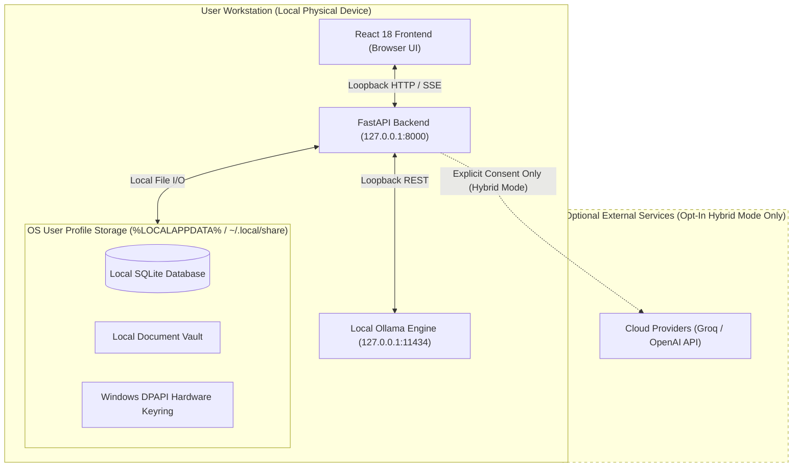
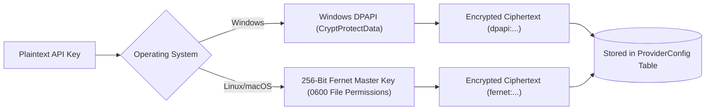

# Quantum Council — Privacy & Local-First Architecture

**Five Minds. One Intelligence.**

This document details Quantum Council's local-first privacy architecture, credential isolation mechanisms, and data boundary guarantees.

---

## 1. Local-First Boundary Architecture

---

## 2. Privacy Guarantees

### Zero Telemetry
- Quantum Council contains no third-party tracking scripts, analytics SDKs (Google Analytics, Mixpanel), or phone-home telemetry.
- All session metadata, deliberation counts, and circuit breaker stats are stored solely in your local SQLite database.

### Local-Only Mode (`local_only`)
- When running in default `local_only` mode, the orchestrator and individual agent chat communicate exclusively with your local Ollama daemon.
- If an agent is mistakenly assigned to an online cloud model while in `local_only` mode, the engine blocks the outbound socket and raises a `ProviderAuthError`.
- No document excerpts, text chunks, or conversation prompts leave your computer.

### Opt-In Hybrid Mode (`hybrid`)
- In Hybrid mode, users may configure their own API credentials for cloud providers (e.g., Groq, OpenAI).
- **Minimum Data Disclosure**: Only the contextual task prompt and relevant retrieved passages are transmitted to the cloud provider; full documents are never uploaded.
- **Provider Transparency**: The application interface explicitly displays which provider and model executed each agent's contribution.

---

## 3. Credential Protection & Windows DPAPI

- On Windows, API keys are encrypted via **Windows DPAPI** (`CryptProtectData`), binding the key directly to the logged-in Windows user's password hash. Another user account on the same physical workstation cannot decrypt the stored credentials.
- API keys are **never returned in API responses**. The frontend only receives masked previews (e.g. `gsk_...3a2f` or `********`).
- Sensitive keys are scrubbed from application logs and tracebacks via `redact_sensitive_text()`.

---

## 4. Local Storage Hygiene & Data Management

Users have complete ownership of their local data via **Settings $\rightarrow$ Data Management**:
- **Storage Metrics**: Real, measured disk usage across chats, deliberation logs, uploaded documents, and vector caches.
- **Atomic Cleanup**: Transactional deletion of conversation history, agent logs, or indexed documents.
- **Master Reset**: Safe `DELETE ALL DATA` operation that purges databases and caches while preserving user preferences and encrypted credentials.
