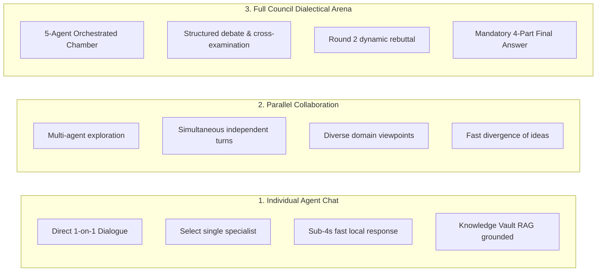

# Quantum Council — Execution Workflows

**Five Minds. One Intelligence.**

This document outlines the core workflows governing agent communication, dialectical debate, document indexing, and user interactions.

---

## 1. Full Council Deliberation Workflow

```mermaid
sequenceDiagram
    autonumber
    actor User
    participant Orch as Orchestrator (LangGraph)
    participant R as Researcher
    participant A as Analyst
    participant Alt as Alternative Thinker
    participant C as Critic
    participant S as Specialist
    participant Rebuttal as Challenged Agent

    User->>Orch: Submit Prompt / Deliberation Goal
    Note over Orch: Inspects Prompt & Ingests Vault RAG Context
    
    Note over Orch,Alt: Phase 1 — Primary Evidence & Analysis
    Orch->>R: Gather empirical baselines & citations
    R-->>Orch: Empirical Baseline (60-120 words)
    Orch->>A: Evaluate feasibility & computational trade-offs
    A-->>Orch: Feasibility Analysis (60-120 words)
    Orch->>Alt: Propose unorthodox & lateral approaches
    Alt-->>Orch: Lateral Proposal (60-120 words)

    Note over Orch,C: Phase 2 — Technical Specification & Review
    Orch->>S: Deliver code spec & mathematical validation
    S-->>Orch: Technical Spec (60-120 words)
    Orch->>C: Cross-examine submissions & challenge assumptions
    C-->>Orch: Dialectical Critique & Specific Agent Challenge

    Note over Orch,Rebuttal: Phase 3 — Dynamic Dialectical Debate
    Orch->>Rebuttal: Critic challenges assumptions (Provide Round 2 rebuttal)
    Rebuttal-->>Orch: Refined Position & Counter-Arguments

    Note over Orch: Phase 4 — Consensus Synthesis
    Orch->>Orch: Formulate Structured 4-Part Final Council Answer
    Orch-->>User: Stream Final Answer + Complete Session Transcript
```

---

## 2. Knowledge Vault RAG Workflow

```mermaid
flowchart TD
    subgraph Ingestion ["Document Ingestion & Indexing"]
        A1["User Uploads PDF / Markdown / Text"] --> A2{"File Validation"}
        A2 -- Extension not allowed --> A3["Reject (HTTP 400)"]
        A2 -- Size > 50MB --> A4["Reject (HTTP 413)"]
        A2 -- Valid Document --> A5["Sanitize Filename & Save Locally"]
        A5 --> A6["Page-by-Page Digital Text Extraction"]
        A6 --> A7["Generate Cohesive Text Chunks (300-650 chars)"]
        A7 --> A8["Calculate Term-Frequency Vectors (Pure-Python TF-IDF)"]
        A8 --> A9[("Persist Chunks & Vectors to SQLite")]
        A9 --> A10["Update In-Memory Fast Vector Cache"]
    end

    subgraph Retrieval ["Query Retrieval & Context Assembly"]
        B1["User Submits Query"] --> B2["Tokenize & Filter English Stopwords"]
        B2 --> B3["Compute Query Term Vector"]
        B3 --> B4["Hybrid Scoring: Cosine Sim + Keyword Coverage + Bigram Boost"]
        B4 --> B5["Rank & Select Top-K Chunks"]
        B5 --> B6["Inject Evidence Block into Researcher / Orchestrator Prompt"]
        B6 --> B7["LLM Synthesizes Answer with [Source: filename, Page X] Citations"]
    end
```



---

## 3. Application Modes

Quantum Council provides three distinct operating modes:



### Mode Comparison Matrix

| Feature | Individual Agent Chat | Parallel Collaboration | Full Council Dialectical Arena |
| :--- | :--- | :--- | :--- |
| **Active Agents** | 1 selected mind | 3 to 5 minds | All 5 minds + Orchestrator |
| **Interaction Style** | Conversational chat | Independent viewpoints | Dynamic dialectical debate |
| **Response Speed** | Fast (~3–5s on CPU) | Moderate (~15–20s) | In-depth (~35–45s) |
| **Cross-Examination** | None | Minimal | Active peer review & rebuttal |
| **Final Synthesis** | Direct agent answer | Aggregate list | Structured 4-part consensus |
| **Ideal For** | Quick tactical questions | Brainstorming angles | Complex architectural decisions |

