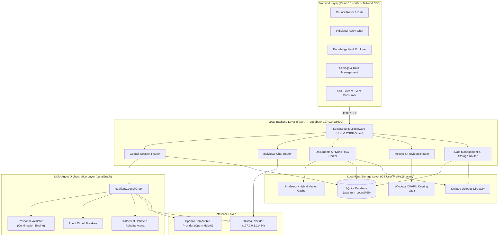

# Quantum Council — System Architecture

**Five Minds. One Intelligence.**

This document provides a technical deep-dive into the architectural design of Quantum Council, detailing the interaction between the React frontend, FastAPI backend, LangGraph orchestrator, Ollama local inference, Knowledge Vault RAG, and the local-first storage subsystem.

---

## High-Level System Architecture

---

## Subsystem Details

### 1. Presentation Layer (React 18 + Vite)
- **Glassmorphic Command Center**: Powered by CSS custom properties, GPU-accelerated backdrop blur filters, and liquid glass reflections.
- **Council Dais**: Interactive avatar chamber reflecting dynamic agent states (`queued`, `speaking`, `responding`, `reviewing`, `completed`) in real-time.
- **Server-Sent Events (SSE)**: Non-blocking event streaming via `fetchEventSource`, delivering incremental deliberation tokens and stage banners live to the user.

### 2. API Gateway & Boundary Enforcement (FastAPI)
- **Loopback-Only Interface**: Bound to `127.0.0.1` by default to prevent external local network probing.
- **Host Header Anti-DNS Rebinding**: Inspects HTTP `Host` headers against whitelisted loopback addresses (`127.0.0.1`, `localhost`, `[::1]`).
- **Cross-Origin CSRF Protection**: Validates `Origin` on all state-mutating HTTP methods (`POST`, `PUT`, `DELETE`, `PATCH`). External sites are blocked with `403 Forbidden`.

### 3. Fault-Tolerant Orchestrator (LangGraph)
- **Five Specialized Minds**: Decomposes user goals into empirical, analytical, alternative, critical, and implementation tasks.
- **Circuit Breakers & Graceful Degradation**: Monitors agent response failures and automatically substitutes fallback roles without halting execution.
- **Mandatory 4-Part Synthesis**: Guarantees a direct answer, key council insights, recommendation, and important considerations regardless of upstream partial outages.

### 4. Grounded Knowledge Vault (Hybrid RAG)
- **Pure-Python Text Extraction**: Page-by-page PDF extraction using `pypdf`.
- **Hybrid Scoring**: Combines cosine vector similarity with exact keyword coverage and bigram phrase boosts.
- **Verifiable Citations**: Every retrieved chunk retains page numbers and document filenames, strictly cited in final answers.
